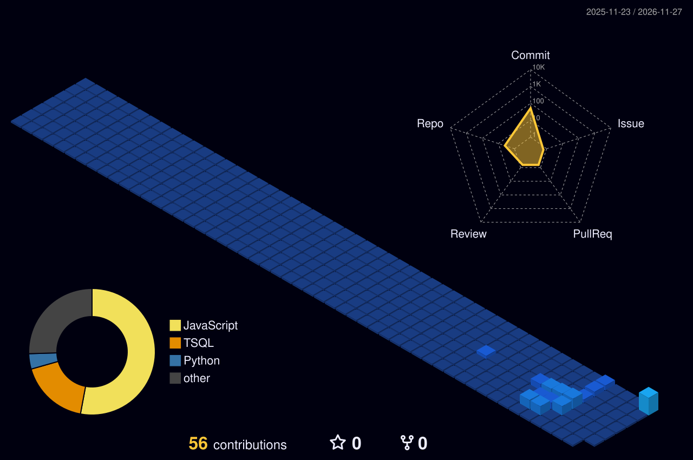

<div align="center">


<a href="https://github.com/aaron-sam-jordan">
  
</a>

<br/>


<br/>

[](https://www.linkedin.com/in/YOUR-LINKEDIN)
[](mailto:YOUR-EMAIL@gmail.com)
[](https://github.com/aaron-sam-jordan)

<br/>


</div>

---

## About

<div align="center">

<table>
<tr>
<td>

I am a final-year Information Technology student aiming for an entry-level data analyst role. I use SQL, Python and Power BI to find answers in messy data, and I have built two end-to-end projects: a SQL Server and Power BI analysis of late deliveries, and a full stack resume analysis app.

I use AI tools to speed up development, and I make sure I understand and can explain every query and line of code I ship. Beyond analysis, I have hands-on experience with Flask and React, REST APIs, Postman testing and Docker from two internships.

**Open To**

- Entry-level Data Analyst roles
- Data and BI internships
- Collaboration on data projects

</td>
</tr>
</table>

</div>

---

## Tech Stack

<div align="center">

**Languages and Analytics**


**Libraries**


**Frameworks**


**Developer Tools**


</div>

---

## Data Skills

<div align="center">

| Skill | Level | What I did with it |
|:-----:|:-----:|:-------------------|
| SQL | Hands-on | CTEs, window functions, aggregations and joins across a 9-table dataset |
| Power BI | Hands-on | Interactive dashboard with slicers for delivery performance and revenue |
| Python | Hands-on | pandas, NumPy and Matplotlib for analysis; Flask for APIs |
| Reporting | Hands-on | Documented findings with the scripts in a GitHub repository |

</div>

---

## Featured Projects

<details>
<summary><b>E-Commerce Delivery Analysis</b></summary>

<br/>

Analysis of a Brazilian e-commerce dataset to find the causes of late deliveries.

| | |
|:--|:--|
| **Stack** | SQL Server, SSMS, Power BI, GitHub |
| **Scale** | 9 tables: orders, customers, sellers, payments, reviews and more |
| **Method** | 8 analytical queries using CTEs, window functions, aggregations and joins |
| **Impact** | Late-delivery rates by customer and seller state, plus a monthly revenue trend with a running total |
| **Repository** | [ecommerce-delivery-analysis](https://github.com/aaron-sam-jordan/ecommerce-delivery-analysis) |

An interactive Power BI dashboard with slicers shows delivery performance and revenue. All SQL scripts and findings are published in the repository.

</details>

<details>
<summary><b>Resume Analyser</b></summary>

<br/>

A full stack web app that scores an uploaded resume against a job description and reports matched and missing skills.

| | |
|:--|:--|
| **Stack** | Python, Flask, React, SQL Server, REST API |
| **Scale** | User and admin roles, with analysis history stored in SQL Server through ODBC |
| **Features** | Resume-length checks, experience-years detection and improvement suggestions |
| **Security** | Role-based access, OTP password reset over email, admins blocked from viewing resumes |
| **Repository** | [resume-analyser](https://github.com/aaron-sam-jordan/resume-analyser) |

Includes a React admin dashboard with KPI cards and line, bar and pie charts to track users and analyses.

</details>

---

## Experience

<div align="center">

<table>
<tr>
<td>

### Software Development Intern &nbsp;|&nbsp; Amizhth Techno Solutions

`[ADD DATES]` &nbsp;|&nbsp; Madurai, Tamil Nadu

**Scope of work**

- Worked in a team to build an e-commerce website, from planning to a working application
- Tested and debugged REST API endpoints using Postman
- Containerised the application with Docker for a consistent setup across the team
- Collaborated with team members on development tasks and code updates


</td>
</tr>
</table>

<table>
<tr>
<td>

### Python Development Intern &nbsp;|&nbsp; Zayith Technologies

`[ADD DATES]` &nbsp;|&nbsp; Madurai, Tamil Nadu

**Scope of work**

- Learned Python fundamentals and wrote working programs using AI-assisted development
- Practised writing, running and debugging Python code on hands-on tasks


</td>
</tr>
</table>

</div>

---

## GitHub Analytics

<div align="center">


</div>

---

## Contribution City

<div align="center">

</div>

---

## Current Focus

```yaml
learning:
  - Advanced SQL for analytics
  - Power BI dashboards and data storytelling
building:
  - Football tactics analysis (StatsBomb open data)
exploring:
  - Docker and cloud deployment
open_to:
  - Entry-level Data Analyst roles
```

---

## Connect

<div align="center">

[](mailto:YOUR-EMAIL@gmail.com)
[](https://www.linkedin.com/in/YOUR-LINKEDIN)
[](https://github.com/aaron-sam-jordan)

</div>

---

<div align="center">

*Data tells the story. Analysis gives it a voice.*


</div>
